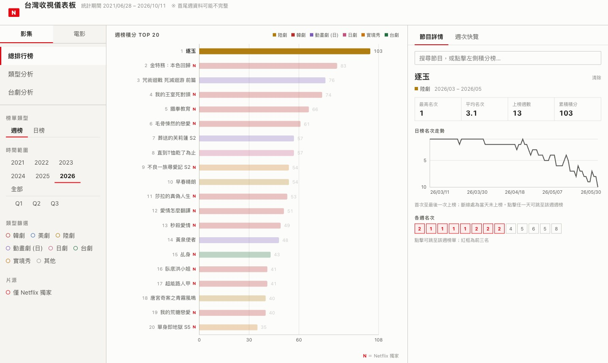
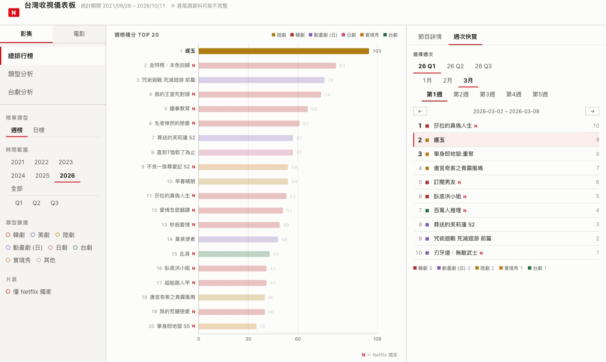
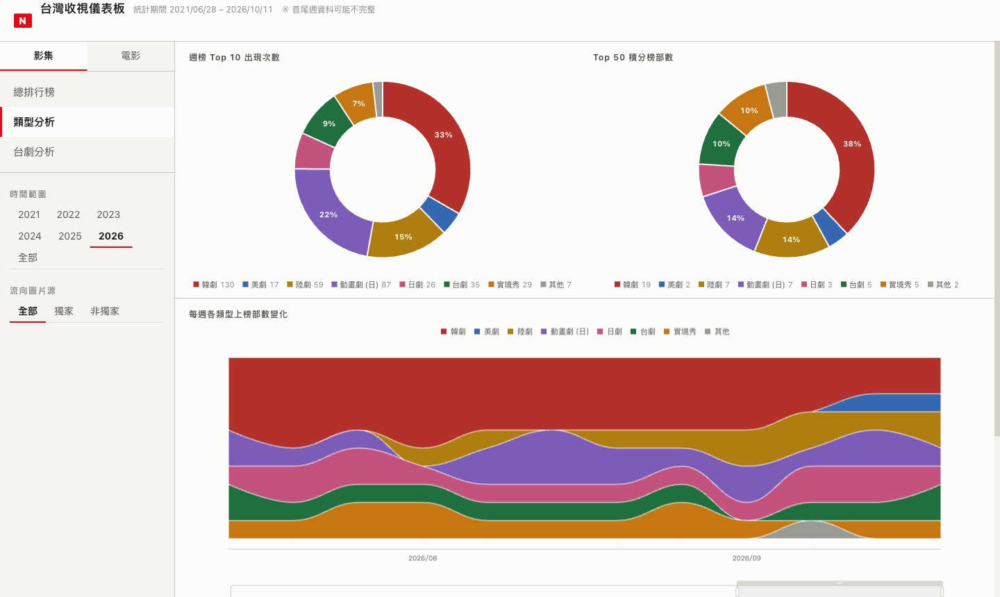
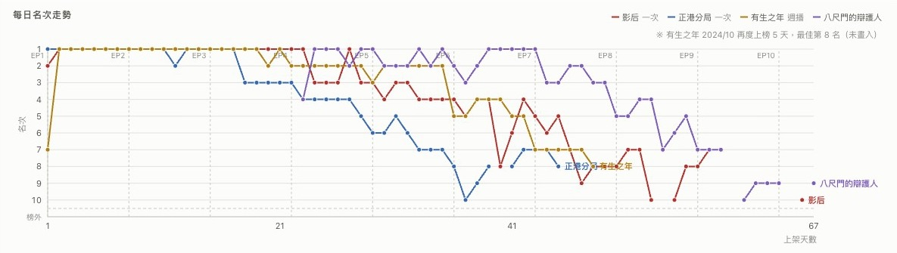
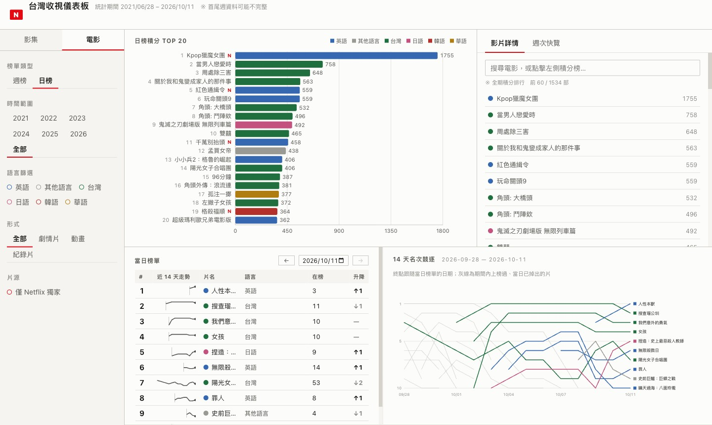

# Netflix 台灣收視儀表板

把 Netflix 台灣的每日與每週排行，整理成 2021 年至今的歷史資料庫，並做成可以比較作品、類型與上架策略的互動儀表板。

**Live Demo：** https://jinfer68.github.io/netflix-taiwan-dashboard/
**作品集案例：** https://jinfer68.github.io/portfolio/#/netflix-dashboard

---

<!-- stats:start -->
## 資料範圍（2026-10-11 更新）

| 項目 | 數量 | 期間 |
|---|---|---|
| 日榜（影集／電影各 Top 10） | 1,961 天 | 2021-04-05 ～ 2026-10-11 |
| 官方週榜 | 275 週 | 2021-06-28 ～ 2026-10-04 |
| 上榜影集 | 857 部 | |
| 上榜電影 | 1,538 部 | |
| 台灣節目（含綜藝） | 96 部 | |

日榜缺漏：2023 年缺 52 天。電影頁的介面上會標示每一年的資料涵蓋天數。
<!-- stats:end -->

- **日榜**：自行整理的歷史日榜，2021-04 起。
- **週榜**：[Netflix 官方 Top 10](https://www.netflix.com/tudum/top10)（台灣）。少數對不到中文片名的作品顯示官方英文片名。
- 本站非 Netflix 官方網站，資料僅供學習、研究與作品展示使用。

---

## 畫面

### 總排行榜

把週榜或日榜的名次換成積分（第 1 名 10 分、第 10 名 1 分），可依年份、季度、類型與是否為 Netflix 獨家篩選。點選作品可看最高名次、平均名次、上榜週數與日榜名次走勢。



週次快覽：回到任一週，直接看當週 Top 10 與類型分布。



### 類型分析

「週榜 Top 10 出現次數」看聲量，「Top 50 積分榜部數」看有多少作品站得住；下方的流向圖把每週各類型的上榜部數放在時間軸上。



### 台劇分析

X 軸用「上架後第 N 天」而不是日期，讓不同時間上架的作品放在同一個起點比較；週播劇在第 1、8、15… 天標出新集上線。



### 電影

電影汰換速度約是影集的兩倍，另外設計了可指定日期的當日榜單、14 天名次競逐，以及產地與形式（劇情片／動畫／紀錄片）篩選。



---

## 計算規則

### 積分

```text
第 1 名 → 10 分、第 2 名 → 9 分 …… 第 10 名 → 1 分
```

把名次換成積分後，不同週、不同期間的作品才能用同一把尺比較。

### 台劇走勢的「第 N 天」

- **檔期段**：同一部作品相鄰兩個上榜日相隔 30 天以上，就切成新的一段。上榜天數最多的一段是主檔期，走勢圖只畫主檔期；其他段落（回鍋或分批上架）以文字註記，不把 X 軸拉長。
  門檻取 30 天的依據：相鄰上榜日的間隔分布呈雙峰，28 天與 33 天之間沒有任何資料。
- **第 1 天**：TMDB 該季首播日。以下情況改用主檔期第一次上榜日：
  - 首播日晚於第一次上榜（TMDB 日期與台灣上架日不同）
  - 首播日比第一次上榜早 30 天以上（TMDB 記的是電視台首播，Netflix 晚很久才上架）。首播到第一次上榜的天數，在 22 天與 43 天之間沒有資料。

---

## 資料流程

```text
歷史日榜（2021-04 起）＋ Netflix 官方週榜
        ↓
資料管線（私人 repo）：片名對應、作品主檔、TMDB 查證、驗證
        ↓
build_site_data.py 產生 rankings.json、movies.json
        ↓
本 repo：public/data/ ＋ React 前端 → GitHub Pages
```

資料管線放在私人 repo，本 repo 只放前端與產生好的兩個 JSON。推上 `main` 後由 GitHub Actions 自動建置並部署。

### 更新資料（自動）

資料管線每次提交資料（`commit_data.py`）後，會自動執行 `scripts/sync_public_site.py`：重新產生兩個 JSON、同步前端 `site/src/` → `src/`、更新本文件上方的資料範圍表、本機建置通過後推上本 repo 的 `main`。`vite.config.ts` 不同步（`base` 保持 `/netflix-taiwan-dashboard/`）。

只改了前端時，在資料管線 repo 手動跑一次：

```bash
.venv/bin/python scripts/sync_public_site.py            # 同步並推送
.venv/bin/python scripts/sync_public_site.py --dry-run  # 只看會改什麼
```

本 repo 的 `src/`、`public/data/`、`README.md` 等同步路徑有未提交的修改時，同步會停下來不覆蓋；要改前端請改資料管線的 `site/src/`。

### 舊版流程

`scripts/` 裡的 `convert_excel.py`、`convert_movies.py` 是 2026-10 之前以 Excel 為資料庫的舊流程，已由上面的資料管線取代，保留作為紀錄。`scripts/tests/` 檢查的是 `public/data/` 的輸出性質，兩種流程都適用：

```bash
pip install -r requirements.txt
pytest scripts/tests
```

---

## 技術

- **前端**：React 18、TypeScript、Vite、Recharts、ECharts。全部使用 inline style，視覺規範見 [`docs/design-guidelines.md`](docs/design-guidelines.md)
- **資料**：Python、JSON、TMDB API
- **部署**：GitHub Actions → GitHub Pages

### 本機開發

```bash
npm install
npm run dev
```

---

## 我的角色

我負責資料來源判斷、資料管線與資料格式設計、清理與分類規則、儀表板需求與資訊設計，以及結果驗證。實作過程使用 Claude Code 作為 AI coding assistant 加速開發；資料結構、分析邏輯與設計取捨由我決定，主要功能都先寫設計規格（見 [`docs/superpowers/specs/`](docs/superpowers/specs/)）再實作。
